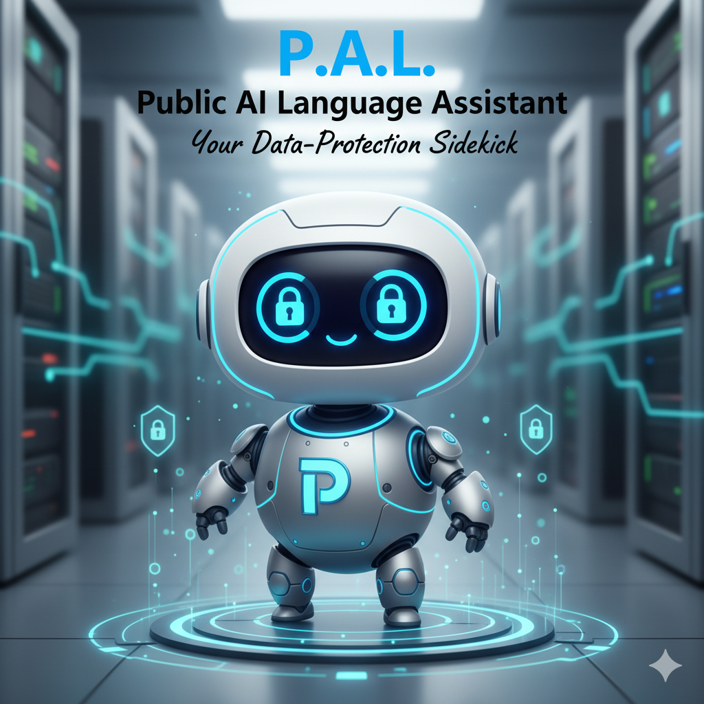

# P.A.L. Public AI Language Assistant

Deliver a lightweight, self-hostable, privacy-first language model stack that any community, small business, or individual can run locally and keep 100% of the data on their own hardware.



## Description

**P.A.L.** is a modular, open-source AI platform that lets anyone run a state-of-the-art language model on their own hardware — no cloud, no data-outs. Built on top of **vLLM**, **Open WebUI**, **Kokoro**, **Docling**, and **searXNG**, the stack is packaged in a single Docker-Compose file that you can **easily update** (pull a new image, rebuild a Dockerfile, or switch tags) and the system will automatically restart with the new version. It is accessed through a Caddy-based reverse proxy that obtains certificates via Cloudflare and can be refreshed with a single `docker compose pull` + `docker compose up -d`. P.A.L. empowers local knowledge workers, educators, and hobbyists to have a private, always-on AI assistant that respects their privacy while staying cutting-edge.

## Summary

1. **Self-hosted, zero-cloud** — run everything on your own server or workstation, no external API calls.
2. **Easy to update, self-patch** — a simple Docker pull and compose-up keeps the stack current without manual edits.
3. **Community-friendly** — all code is on GitHub, all docs are Markdown, and the Docker stack can be pulled and launched in a few minutes.

## Security at the Core

P.A.L. is engineered with *security-by-design* in mind.

- **Local data residency** — all user data stays on the host; the LLM inference, embeddings, TTS, and document parsing all run on your own hardware with no outbound calls to cloud model providers.
- **Single public entry point** — only the Caddy reverse proxy is exposed to the internet; the vLLM, Kokoro, and Docling services are reached only through Caddy (or the host, if you open their ports).
- **Minimal attack surface** — internal services such as the main vLLM container are not published to the host at all, so a compromised web tier cannot reach the model runtime directly.
- **Immutable image updates** — by pinning tags in the Compose file and using a controlled updater, you avoid "unknown-source" updates and retain full control over which releases are deployed.
- **Transparent provenance** — every component is open-source and publicly audited; pull requests and vulnerability scans are part of the normal development cycle, so you can verify the integrity of the code before you run it.
- **Runtime patching** — optional post-restart commands (e.g., `apt-get upgrade -y`) keep the underlying OS packages current without a full rebuild, protecting against known CVEs.

Together, these measures give you a **secure, self-contained AI assistant** that you can trust to keep your data confidential while still delivering state-of-the-art language capabilities.

---

## Table of Contents

| Section | Description |
|---------|-------------|
| [What it is](#what-it-is) | Overview of the stack |
| [Architecture](#architecture) | Services & networking |
| [Prerequisites](#prerequisites) | Hardware & software requirements |
| [Getting Started](#getting-started) | Quick-start steps |
| [Hugging Face Setup](#hugging-face-setup) | Install the `hf` CLI and download models |
| [Configuration](#configuration) | `.env`, `Caddyfile`, and other files |
| [Persistence & Backup](#persistence-and-backup) | Where data lives |
| [Upgrading & Maintenance](#upgrading--maintenance) | Keeping the stack up-to-date |
| [Troubleshooting](#troubleshooting) | Common issues & fixes |
| [License & Credits](#license--credits) | Who built this? |

---

## What It Is

P.A.L. Public AI Language Assistant is a **single-file Docker-Compose** stack that gives you:

| Service | Image | Purpose |
|---------|-------|---------|
| **Open WebUI** | `ghcr.io/open-webui/open-webui:main` | Front-end chat UI; connects to vLLM, embeddings, TTS, and RAG. |
| **vLLM** | `vllm/vllm-openai:latest` | Main LLM runtime (GPU) — serves `Inferact/Qwen3.8-27B-NVFP4`. |
| **vLLM Embed** | `vllm/vllm-openai:latest` | Embedding runtime — serves `Qwen/Qwen3-Embedding-0.6B` for RAG. |
| **vLLM Gemma** | `vllm/vllm-openai:latest` | Alternative LLM runtime — serves `nvidia/Gemma-4-26B-A4B-NVFP4`. |
| **Kokoro** | `ghcr.io/remsky/kokoro-fastapi-gpu:latest` | Text-to-speech (TTS) for Open WebUI audio. |
| **Docling** | `quay.io/docling-project/docling-serve:latest` | Document parsing for RAG (PDFs, docs, images). |
| **searXNG** | `searxng/searxng:latest` | Private web search for Open WebUI / RAG. |
| **Caddy** | `ghcr.io/caddybuilds/caddy-cloudflare:latest` | Reverse proxy; obtains certificates via Cloudflare. |
| **Hugging Face** | (host `hf` CLI) | Downloads models into a single shared cache to save space. |

All vLLM containers share one Hugging Face cache mounted from `/opt/llm-models/huggingface` on the host. The stack is reached through **Caddy** on your domain(s); the main vLLM service is **not** exposed to the host, and only Open WebUI is intended as the public endpoint.

---

## Architecture

```
                    Private Intanet
                        │ HTTPS (443) / HTTP (80)
                        ▼
               ┌───────────────┐
               │  Caddy (CF)   │  ghcr.io/caddybuilds/caddy-cloudflare
               │  reverse_proxy│
               └───────┬───────┘
                       ▼
               ┌───────────────┐
               │  open-webui    │  ghcr.io/open-webui/open-webui:main
               │  (named volume)│
               └──────┬────────┘
       ┌───────────┬──┴───────────┬──────────────┐
       ▼           ▼              ▼              ▼
  ┌────────┐  ┌─────────┐  ┌───────────┐  ┌──────────────┐
  │  vllm  │  │ vllm-   │  │ vllm-     │  │ kokoro-      │
  │ Qwen   │  │ embed   │  │ gemma-4   │  │ fastapi      │
  │ :8000  │  │ :8000   │  │ :8000     │  │ :8880 (TTS)  │
  └────────┘  └─────────┘  └───────────┘  └──────────────┘
        all three read models from /opt/llm-models/huggingface

  searxng  (web search)  ──────► open-webui  (RAG web search)
  docling  (:5001)        ──────► open-webui  (RAG document parser)
```

- **Shared model cache** — every vLLM container mounts `/opt/llm-models/huggingface` as `/root/.cache/huggingface`, so models downloaded once on the host are reused by all of them. This is why the stack saves space: there is one Hugging Face cache, not one per service.
- **GPU sharing** — the three vLLM containers and Kokoro all request the NVIDIA GPU. Their `--gpu-memory-utilization` values are tuned so they coexist on a single GPU (main `0.38`, embed `0.08`, Gemma `0.30`).
- **Health ordering** — `vllm-gemma-4` waits for the main `vllm` to pass its health check before starting, and `open-webui` waits for `vllm` to start.
- **Caddy** reads the `Caddyfile` for routing and uses `CLOUDFLARE_API_TOKEN` to obtain/renew certificates through Cloudflare.
- **Persistence** — Open WebUI and Caddy use Docker named volumes; searXNG and the model cache use bind mounts. A container restart or image upgrade never wipes your settings or models.

---

## Prerequisites

- **Docker** ≥ 20.10
- **Docker-Compose** ≥ 1.29
- **NVIDIA GPU** with the NVIDIA container runtime (`runtime: nvidia`) — required for vLLM, Kokoro, and Docling.
- A public domain with DNS managed by **Cloudflare** (Caddy uses a Cloudflare API token for DNS-01 certificate issuance).
  - CNAME/alias your domain(s) to your server IP (or to your Cloudflare proxy).
- **Two Docker named volumes** must exist before the stack starts (the compose marks them `external: true`):
  ```bash
  docker volume create open-webui
  docker volume create caddy_data
  docker volume create caddy_config
  ```

> **No GPU?** This compose is built around GPU inference (vLLM, Kokoro, Docling all request the NVIDIA runtime). If you don't have an NVIDIA GPU, you must remove the `runtime: nvidia` and `deploy.resources` blocks for the affected services, or the containers will not start.

---

## Getting Started

### 1. Clone & Prepare

```bash
git clone https://github.com/DamienGreathouse/P.A.L.-Public-AI-Language-Assistant.git
cd P.A.L.-Public-AI-Language-Assistant

# The repo provides a ready-to-run docker-compose.yml.
# (If a GPU-specific variant is provided, copy it over docker-compose.yml.)
```

### 2. Edit `.env`

```bash
cp env.example .env
```

Edit `.env` and set the values for your environment:

```bash
# ── VLLM / Open WebUI API Key (shared) ──
# A strong, random string shared by the vLLM containers and Open WebUI.
# Generate one with:  openssl rand -base64 32
VLLM_API_KEY=REPLACE_WITH_STRONG_RANDOM_STRING

# ── Caddy / Cloudflare ──
# Cloudflare API token with DNS edit + Zone:Settings:Read permissions.
# Format: cfut_...  — create at https://dash.cloudflare.com/profile/api-tokens
CLOUDFLARE_API_TOKEN=REPLACE_WITH_CLOUDFLARE_API_TOKEN

# ── Open WebUI ──
# A strong, random secret used to sign Open WebUI sessions.
# Generate one with:  openssl rand -base64 32
WEBUI_SECRET_KEY=REPLACE_WITH_STRONG_RANDOM_STRING

# Your public HTTPS domain (used by the Caddyfile and by Open WebUI)
OPEN_WEBUI_BASE_URL=https://pal.example.com

# ── Microsoft Entra (SSO) ──
# Application (client) ID from your Microsoft Entra App Registration.
MICROSOFT_CLIENT_ID=REPLACE_WITH_ENTRA_CLIENT_ID

# Application secret from the same registration (use a fresh secret, not a reused one).
MICROSOFT_CLIENT_SECRET=REPLACE_WITH_ENTRA_CLIENT_SECRET

# Directory (tenant) ID.
MICROSOFT_CLIENT_TENANT_ID=REPLACE_WITH_ENTRA_TENANT_ID

# Redirect URI must match the value registered in Entra App Registration.
MICROSOFT_REDIRECT_URI=https://pal.example.com/oauth/microsoft/callback

# OIDC discovery endpoint, using your tenant ID.
OPENID_PROVIDER_URL=https://login.microsoftonline.com/REPLACE_WITH_ENTRA_TENANT_ID/v2.0/.well-known/openid-configuration

# ── OneDrive / SharePoint ──
# Application (client) ID from your Business App Registration.
ONEDRIVE_CLIENT_ID_BUSINESS=REPLACE_WITH_BUSINESS_CLIENT_ID

# Directory (tenant) ID of the SharePoint/OneDrive tenant.
ONEDRIVE_SHAREPOINT_TENANT_ID=REPLACE_WITH_SHAREPOINT_TENANT_ID

# Root URL of your SharePoint instance.
ONEDRIVE_SHAREPOINT_URL=https://your-tenant-name.sharepoint.com
```

> **Note:** The vLLM containers, Open WebUI's OpenAI backend, and the embedding client all use the **same** `VLLM_API_KEY`.

### 3. Prepare Directories & Volumes

```bash
# Bind-mount directories
mkdir -p searxng

# Ensure the shared Hugging Face cache exists (see Hugging Face Setup below)
# /opt/llm-models/huggingface

# Named volumes (required because the compose marks them external: true)
docker volume create open-webui
docker volume create caddy_data
docker volume create caddy_config
```

### 4. Start the Stack

```bash
docker compose up -d
```

> Caddy will request certificates through Cloudflare (first run may take a minute). The main vLLM container has a long `start_period` (1200s) while it loads the model — it is expected to take a while before its health check passes.

### 5. Verify

```bash
curl -I https://pal.example.com
# Should return 200 and a TLS certificate

docker compose ps
# vllm should become "healthy" before open-webui can use it
```

Open your browser to `https://pal.example.com` — you should see the Open WebUI dashboard.

---

## Hugging Face Setup

This section covers installing and configuring the Hugging Face CLI (`hf`) on your host so you can pre-download models into the shared cache that all vLLM containers read.

- **User account:** `itadmin`
- **Hugging Face home (host):** `/opt/llm-models/huggingface`
- **Inside containers:** the same directory is mounted as `/root/.cache/huggingface`

> vLLM can pull models on first start, but pre-downloading them with `hf` avoids slow, flaky first-run pulls and guarantees the containers have what they need.

### 1. Create the Hugging Face Directory

```bash
sudo mkdir -p /opt/llm-models/huggingface
sudo chmod 755 /opt/llm-models/huggingface
sudo chown -R itadmin:itadmin /opt/llm-models/huggingface
```

> **Note:** The `chown` step is important. The directory must be owned by your user (`itadmin`), not root, or the CLI cannot write downloaded models to it.

### 2. Point Hugging Face at That Directory

Edit `~/.bashrc` and add (or correct) the following lines:

```bash
export HF_HOME=/opt/llm-models/huggingface
export HF_HUB_CACHE=/opt/llm-models/huggingface
export HF_DATASETS_CACHE=/opt/llm-models/huggingface
export PATH="$HOME/.local/bin:$PATH"
```

Reload the shell and verify:

```bash
source ~/.bashrc
echo "$HF_HOME"            # /opt/llm-models/huggingface
echo "$HF_HUB_CACHE"       # /opt/llm-models/huggingface
echo "$HF_DATASETS_CACHE"  # /opt/llm-models/huggingface
```

### 3. Install the `hf` CLI

Run the installer **as your user** (not with `sudo`). Running it with `sudo` installs it to a location your shell cannot reach.

```bash
curl -LsSf https://hf.co/cli/install.sh | bash
```

> **If the installer fails because `python3-pip` is missing:**
>
> ```bash
> sudo apt install -y python3-pip
> ```

Confirm the CLI is available:

```bash
hf
```

### 4. Authenticate

```bash
hf auth login      # paste your Hugging Face token
hf auth whoami     # verify the login
```

### 5. Download the Models the Stack Uses

Pre-download the models referenced by the vLLM containers into the shared cache:

```bash
# Main model + its speculative (DFlash) model
hf download Inferact/Qwen3.8-27B-NVFP4 --repo-type model
hf download incoai/Qwen3.8-27B-DFlash2 --repo-type model

# Embeddings
hf download Qwen/Qwen3-Embedding-0.6B --repo-type model

# Gemma + its speculative (MTP) model
hf download nvidia/Gemma-4-26B-A4B-NVFP4 --repo-type model
hf download google/gemma-4-26B-A4B-it-assistant --repo-type model
```

> **Check the exact repository names** on Hugging Face before downloading — names can differ slightly. Confirm each repo exists before running the command.

### Quick Reference

| Purpose | Command |
|---|---|
| Create and fix ownership | `sudo mkdir -p /opt/llm-models/huggingface && sudo chown -R itadmin:itadmin /opt/llm-models/huggingface` |
| Install the CLI | `curl -LsSf https://hf.co/cli/install.sh \| bash` |
| Sign in | `hf auth login` |
| Check login | `hf auth whoami` |
| Download a model | `hf download <repo> --repo-type model` |

### Troubleshooting

| Symptom | Fix |
|---|---|
| `hf: command not found` | Ensure `~/.local/bin` is in `PATH` and run `source ~/.bashrc`. |
| Permission denied when downloading | Confirm the directory is owned by your user: `sudo chown -R itadmin:itadmin /opt/llm-models/huggingface`. |
| `hf auth whoami` says not logged in | Run `hf auth login` and paste your token. |
| Installer fails | Install pip first: `sudo apt install -y python3-pip`. |
| vLLM can't see a downloaded model | Confirm the model is under `/opt/llm-models/huggingface` (it is mounted as `/root/.cache/huggingface` in the containers). |

---

## Configuration

| File | Purpose |
|------|---------|
| `.env` | Runtime variables — `VLLM_API_KEY`, `CLOUDFLARE_API_TOKEN`, `OPEN_WEBUI_BASE_URL`, `WEBUI_SECRET_KEY`, Microsoft SSO, OneDrive. |
| `Caddyfile` | Routing & TLS — routes to `open-webui`; uses Cloudflare via `${CLOUDFLARE_API_TOKEN}`. |
| `docker-compose.yml` | Defines services, volumes, GPU access, and shared model cache. |
| `searxng/` | searXNG configuration directory (bind-mounted). |

### Caddyfile Highlights

```caddy
# Cloudflare token for DNS-01 certificate issuance (from .env)
# Token is provided to the caddy-cloudflare image via CLOUDFLARE_API_TOKEN.

${PAL_DOMAIN} {
    reverse_proxy open-webui:8080
}
```

> The `caddy-cloudflare` image uses the Cloudflare API token for certificate issuance instead of Let's Encrypt, so no `email` / Let's Encrypt block is required.

---

## Persistence & Backup

| Service | Location | What's stored | Type |
|---------|----------|---------------|------|
| vLLM (all) | `/opt/llm-models/huggingface` | Downloaded Hugging Face models | Bind mount (shared) |
| searXNG | `./searxng` | searXNG configuration | Bind mount |
| Open WebUI | `open-webui` volume | SQLite DB, settings | Named volume |
| Caddy | `caddy_data` volume | TLS certs, Caddy logs | Named volume |
| Caddy | `caddy_config` volume | Caddy overrides | Named volume |

**Backup tip** — back up the bind mounts on the host, and export the named volumes:

```bash
# Bind mounts
tar czf backup-$(date +%F).tar.gz \
  searxng/ \
  /opt/llm-models/huggingface/

# Named volumes
docker run --rm -v open-webui:/data -v $(pwd):/backup alpine \
  tar czf /backup/open-webui.tar.gz -C /data .
docker run --rm -v caddy_data:/data -v $(pwd):/backup alpine \
  tar czf /backup/caddy_data.tar.gz -C /data .
docker run --rm -v caddy_config:/data -v $(pwd):/backup alpine \
  tar czf /backup/caddy_config.tar.gz -C /data .
```

Restore by unpacking to the same paths and running `docker compose up -d` again.

---

## Upgrading & Maintenance

1. **Pull new images** (once per release):

   ```bash
   docker compose pull
   ```

2. **Restart** (to pick up the new images and apply config changes):

   ```bash
   docker compose up -d
   ```

3. **Upgrade models** — re-run `hf download <repo> --repo-type model` for any new version, or let vLLM pull on first start. Because all vLLM containers share one cache, a model downloaded once is reused by every service.

4. **Check logs**:

   ```bash
   docker compose logs -f caddy
   docker compose logs -f open-webui
   docker compose logs -f vllm
   docker compose logs -f vllm-embed
   docker compose logs -f vllm-gemma-4
   ```

5. **Watch GPU memory** — the three vLLM containers and Kokoro share one GPU. If a container exits with an out-of-memory error, lower the relevant `--gpu-memory-utilization` value in `docker-compose.yml`.

---

## Troubleshooting

| Symptom | Likely Cause | Fix |
|---------|--------------|-----|
| Caddy fails to get a cert | `CLOUDFLARE_API_TOKEN` missing or lacks DNS/Zone permissions | Verify the token in `.env` has DNS edit + Zone:Settings:Read permissions. |
| `vllm` stays "unhealthy" for a long time | Model is still loading (long `start_period`) | Wait; check `docker compose logs -f vllm` for OOM or download errors. |
| vLLM exits with out-of-memory | GPU memory over-subscribed | Lower `--gpu-memory-utilization` for the vLLM containers. |
| vLLM can't find a model | Model not in the shared cache | Pre-download it (see Hugging Face Setup) into `/opt/llm-models/huggingface`. |
| Open WebUI shows "Connection refused" | vLLM not ready yet | Wait for `vllm` to pass its health check, then restart Open WebUI. |
| Embeddings / RAG fail | vllm-embed not up or wrong API key | Confirm `vllm-embed` is healthy and that `VLLM_API_KEY` matches in `.env`. |
| TTS produces no audio | Kokoro not healthy or GPU unavailable | Check `docker compose logs -f kokoro-fastapi` and the NVIDIA runtime. |
| Docling errors on large docs | Sync wait too short | Increase `DOCLING_SERVE_MAX_SYNC_WAIT` in the compose. |
| Container won't start: "could not find runtime nvidia" | NVIDIA runtime not configured | Install the NVIDIA container toolkit and restart Docker. |
| Named volume error on `up` | `external: true` volume doesn't exist | Create it: `docker volume create open-webui` (and the caddy volumes). |

---

## License & Credits

- **Open WebUI** — © Open WebUI Authors (MIT).
- **vLLM** — © vLLM Project (Apache-2.0).
- **Caddy** — © Caddy Server (Apache-2.0).
- **searXNG** — © searxng Authors (AGPL-3.0).
- **Docling** — © Docling Project (Apache-2.0).
- **Kokoro** — © remSky / Kokoro (see upstream license).
- **This stack** — Damien Greathouse (MIT).

Feel free to fork, improve, and share! 🚀
```
